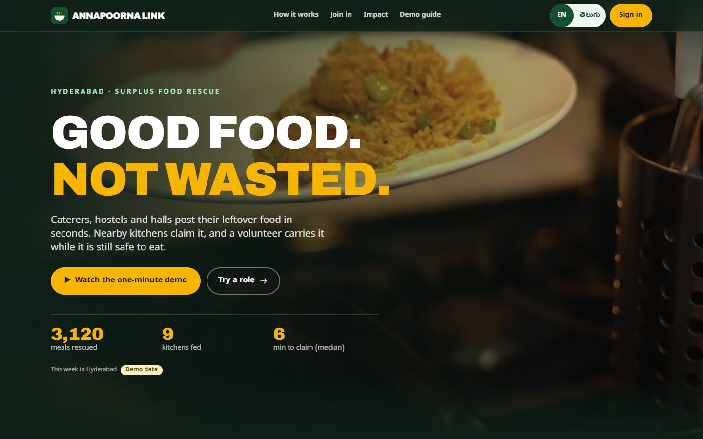
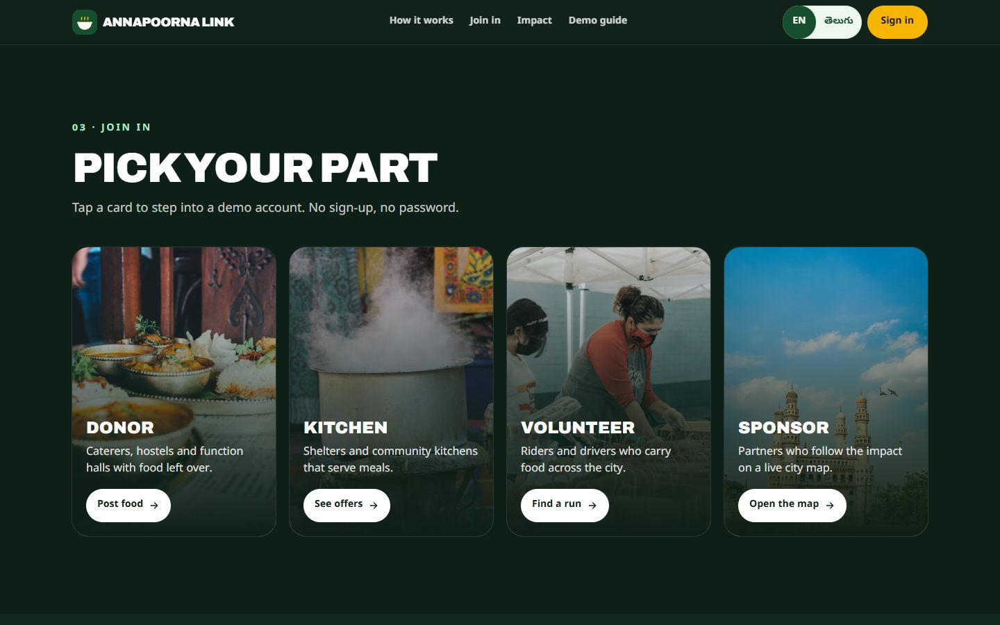
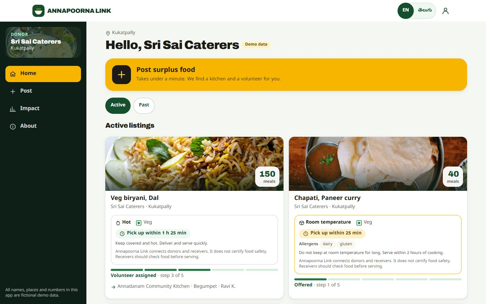
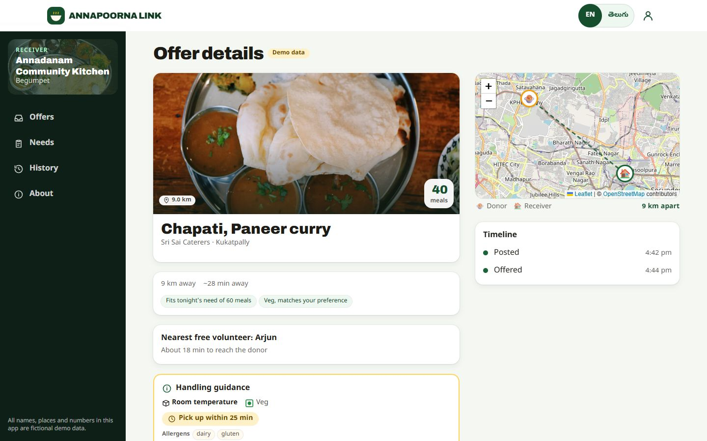
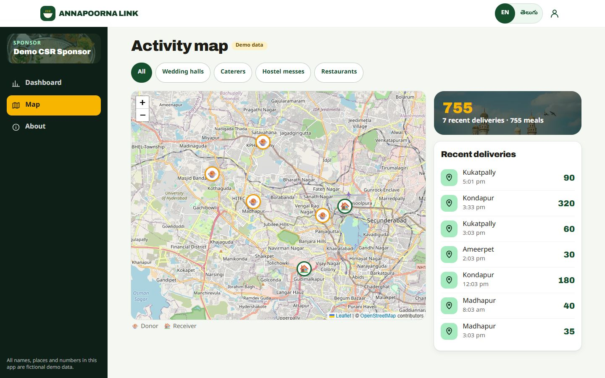
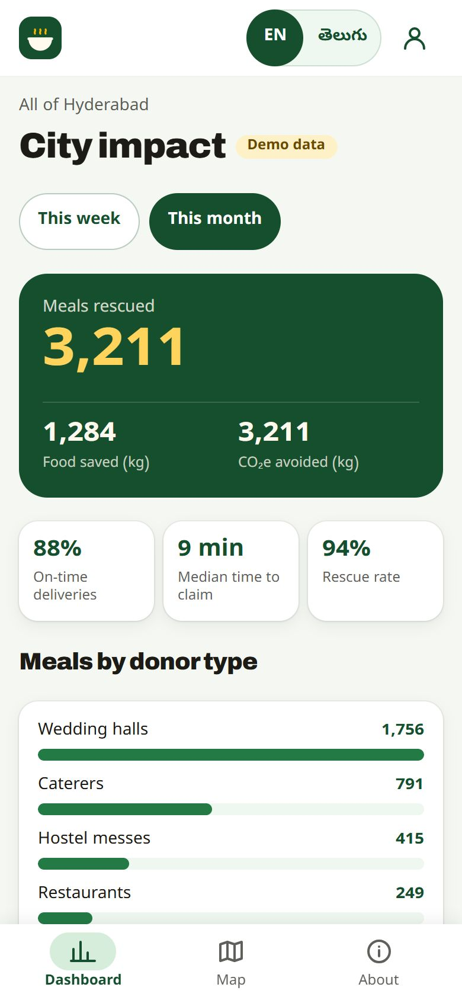
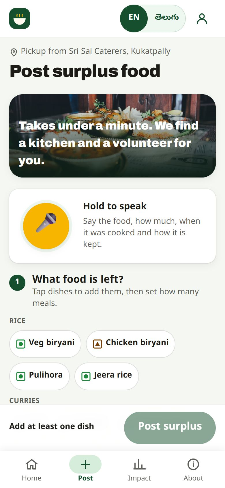
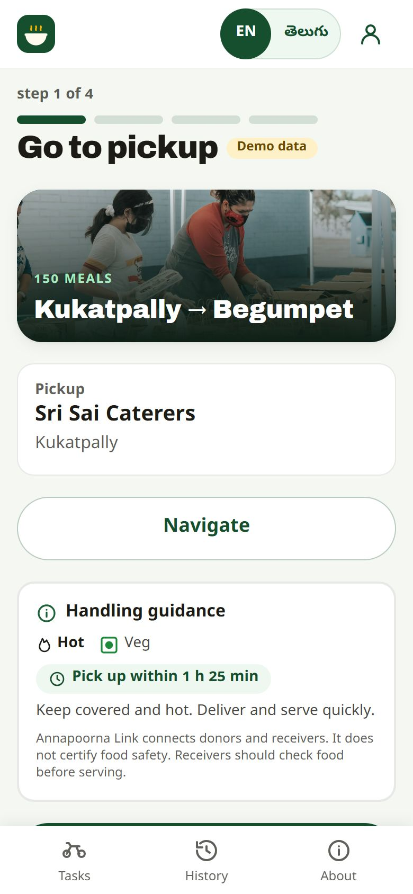

<div align="center">

<h1>Annapoorna Link</h1>

**Surplus food to people who need it, before it spoils.**

A bilingual (English and Telugu) web app that moves leftover food from Hyderabad's caterers, wedding halls and hostel messes to shelters and community kitchens, with a volunteer pickup and a live status at every step.

[](https://annapoorna-link.vercel.app)
&nbsp;
[](#how-it-was-built)
&nbsp;
[](#team)


[Live app](https://annapoorna-link.vercel.app) · [Try it in one minute](#try-it-in-one-minute) · [Screenshots](#screenshots) · [Architecture](#architecture) · [Getting started](#getting-started)

<br />



<sub>Built by team <b>CREED</b> · Duggineni Akhil &amp; Kuchipudi Yokshith</sub>

</div>

---

## Overview

Built by team **CREED** for the **ACE Builders Hackathon 2026**, **Problem Statement 2: Rescue the Surplus** (Society & Environment).

| Resource | Link |
|---|---|
| Live app | [annapoorna-link.vercel.app](https://annapoorna-link.vercel.app) (demo accounts, no sign-up) |
| Demo video | [Watch the demo (5 min)](https://drive.google.com/file/d/1XkI1Ci8rnocW95-fLsMlEKi13o_YaiiR/view?usp=sharing) |
| Live API | [annapoorna-link-api.onrender.com/api/health](https://annapoorna-link-api.onrender.com/api/health) (free tier; the first request after a quiet spell can take about a minute) |
| Build log | [CODEBENDERS_USAGE.md](CODEBENDERS_USAGE.md) |

## Contents

- [Try it in one minute](#try-it-in-one-minute)
- [The problem](#the-problem)
- [The solution](#the-solution)
- [Design](#design)
- [Screenshots](#screenshots)
- [Architecture](#architecture)
- [Safety, privacy and guardrails](#safety-privacy-and-guardrails)
- [Business model](#business-model)
- [Results](#results)
- [Performance and accessibility](#performance-and-accessibility)
- [Getting started](#getting-started)
- [Project structure](#project-structure)
- [How it was built](#how-it-was-built)
- [Credits](#credits)
- [Team](#team)
- [License](#license)

---

## Try it in one minute

No sign-up is needed. The app ships with fictional demo accounts.

**One tap.** Open the [live app](https://annapoorna-link.vercel.app) and press **Watch the one-minute demo**. A caterer posts 150 plates from a wedding, a kitchen accepts, and a volunteer picks up and delivers. A progress panel follows each step live.

**Step into a role.** Under **Pick your part** on the homepage, tap a card to sign straight into that demo account.

**By hand, on three screens:**

1. **Donor:** sign in as **Sri Sai Caterers** and post surplus food.
2. **Kitchen:** in a second window, sign in as **Asha Night Shelter** (veg food) or **Annadanam Community Kitchen** and accept the offer.
3. **Volunteer:** on a phone, sign in as **Ravi K.**, accept the pickup, and confirm both handovers with the 4-digit codes.

On the live deployment, demo donors' posts go to the demo kitchens first at any time of day. The in-app **Demo guide** (`/demo-guide`) walks through the flow. All organisations, people and numbers are fictional.

---

## The problem

It is 10:30 PM and a wedding reception in Kukatpally has just ended, with 150 plates of good food left over.

1. The caterer calls two NGOs. One does not answer; the other is too far away to send anyone.
2. By midnight the food is in the bin, and the caterer pays for its disposal.
3. Six kilometres away, a shelter served smaller portions that night.

Both sides want to help, but there is no fast, reliable way to connect surplus food with the people who need it before it spoils. Coordination runs on phone calls and messaging groups that break down late at night, with no matching, no status and no record of impact.

---

## The solution

| Capability | What it does |
|---|---|
| **Post in under a minute** | Food chips, quantities, storage and allergens, with the latest safe pickup time suggested automatically. Regular donors can repeat their last post. Optional voice posting in English or Telugu. |
| **Explainable matching** | Ranks kitchens by distance, today's need, food preferences (such as veg-only), opening hours and time remaining, then picks the nearest volunteer with enough vehicle capacity. Every match shows its reasons, for example "Fits tonight's need of 60 meals". |
| **Offer cascade** | Each kitchen has 10 minutes to accept before the offer moves to the next one, so food never waits on a single phone call. |
| **Live pickup with handover codes** | Posted → claimed → picked up → delivered, updated live for the donor, kitchen and volunteer. 4-digit codes confirm each handover without GPS tracking. |
| **Safety card on every listing** | Storage, safe-window countdown, allergens, veg/non-veg and handling guidance. Listings expire automatically. The platform never certifies food as safe. |
| **Maps** | Pickup and drop-off areas with the route between them on every offer and task, and a city activity map for sponsors, filtered by donor type. |
| **Impact with stated assumptions** | Meals delivered, kilograms of waste avoided and CO₂e avoided, for each donor and for the city, with weekly charts and a printable monthly report. Only delivered food counts. |
| **Bilingual** | Full English and Telugu interface for business owners, NGO staff, kitchen staff and volunteers. |

### Requirements coverage

| Problem Statement 2 requirement | How Annapoorna Link meets it |
|---|---|
| Donor flow under a minute: what food, how much, pickup-by time | Quick Post with food chips, an auto-suggested pickup-by time and a built-in posting timer |
| Smart matching by distance, quantity, timing and need | Matching engine with eligibility rules, a weighted score and stated reasons; volunteer selection by distance and capacity |
| Pickup coordination with live status: posted → claimed → collected → delivered | Server-enforced state machine, live updates over Server-Sent Events, handover codes |
| Impact view: meals saved and waste avoided, with assumptions | Donor and city dashboards with a "How we calculate this" panel and a printable monthly report |
| Handling and safety information: time window, storage, allergens | Safety card on every listing, offer and task; server-enforced safe windows and automatic expiry |
| Business case for donors and sponsors | Donor Pro, institution plans and CSR area sponsorships (see [Business model](#business-model)) |

---

## Design

The interface has two moods, chosen to suit two different audiences.

| | Public homepage | Working app |
|---|---|---|
| **Audience** | Visitors, sponsors, judges | Donors, kitchens, volunteers, sponsors at work |
| **Look** | Dark and photographic, like a campaign site | Light, calm and dense with information |
| **Layout** | Full-screen video hero, numbered journey, photo role cards, impact strip | Sidebar on desktop, bottom tabs on phones; cards in a responsive grid |
| **Goal** | Explain the idea in seconds and start the demo in one tap | Finish each task fast, with large targets and no clutter |

**Design system**

| Element | Choice |
|---|---|
| Colours | Night green `#0E1F17` (homepage, sidebar), leaf green `#164F2E` (actions), turmeric `#F7B500` (highlights, primary calls to action), mint `#A6EBC0` (accents), mist `#F4F7F2` (app background) |
| Type | Archivo in heavy weights for display headings; Noto Sans Telugu for body text in both languages, so English and Telugu share one look |
| Imagery | Food photos for each food category on listing cards, with a coloured emoji tile underneath if a photo cannot load (offline or blocked) |
| Responsive | Phone-first; from tablet width the app gains a sidebar, wider grids and two-column detail pages with the map and codes in a sticky side column |
| Motion and data | The hero video plays only on wide screens without reduced-motion or data-saver settings; phones get a still photo. Maps load only when shown. |
| Accessibility | 48 px minimum tap targets, WCAG AA contrast, translated labels on every icon button, normal letter-spacing for Telugu, and three text sizes |

---

## Screenshots

<table>
  <tr>
    <td width="50%"><br /><sub><b>Homepage</b>: tap a role card to sign straight into a demo account</sub></td>
    <td width="50%"><br /><sub><b>Donor home</b>: active listings with live progress and this month's impact</sub></td>
  </tr>
  <tr>
    <td width="50%"><br /><sub><b>Kitchen offer</b>: match reasons, handling guidance, route map and timeline</sub></td>
    <td width="50%"><br /><sub><b>Sponsor map</b>: donors and kitchens by area, with recent deliveries</sub></td>
  </tr>
</table>

<table>
  <tr>
    <td align="center" width="33%"><br /><sub><b>Homepage</b> on a phone</sub></td>
    <td align="center" width="33%"><br /><sub><b>Quick Post</b> for donors</sub></td>
    <td align="center" width="33%"><br /><sub><b>Volunteer pickup</b>, step 1 of 4</sub></td>
  </tr>
</table>

Screenshots show fictional demo data from the built-in mock API.

---

## Architecture

```
 Progressive Web App (donor · kitchen · volunteer · sponsor; English and Telugu)
        │  REST + JWT                         ▲  Server-Sent Events
        ▼                                     │
 Backend API (Express): listings · safety guidance · matching · offers · tasks · impact · voice post
        │
        ▼
 PostgreSQL (optional)               Speech-to-text + AI model (voice post, optional)
```

- **Matching score:** `0.4 × proximity + 0.3 × need + 0.2 × time slack + 0.1 × reliability`, applied after eligibility checks (veg-only, opening hours, remaining need, arrival before the pickup-by time). Weights live in configuration and are covered by unit tests.
- **State machine:** posted → offered → claimed → volunteer assigned → picked up → delivered, or expired / cancelled. Only the server changes status, one validated transition at a time; duplicate taps are rejected.
- **Offer cascade:** the top-ranked kitchen gets 10 minutes to accept, then the next. After 5 offers the food opens to every eligible kitchen, and the first to accept receives it. A scheduler expires food at its pickup-by time.
- **Safety windows:** derived from published food-handling guidance for hot, room-temperature and chilled food, with stricter limits for dairy and non-veg. Donors may choose an earlier pickup, never a later one.
- **Storage:** with `DATABASE_URL` set, every change is written to PostgreSQL. Without it, the API runs in memory on the seeded demo data, which is how the live demo is deployed.

### Technology

| Layer | Technology |
|---|---|
| Frontend | React 18, Vite, TypeScript, Tailwind CSS, React Router, PWA (Workbox), Leaflet with OpenStreetMap |
| Backend | Node.js, Express, TypeScript, Zod validation, Helmet, per-user rate limits |
| Database | PostgreSQL with tracked migrations (optional; in memory without it) |
| Realtime | Server-Sent Events, with 15-second polling as a fallback |
| Voice (optional) | Gnani speech-to-text (English and Telugu) and an AI model that turns the transcript into a draft listing |
| Testing | Vitest on both sides: 167 frontend tests and 86 API tests (Supertest) |
| Hosting | Vercel (frontend), Render (API, from [`render.yaml`](render.yaml)) |

---

## Safety, privacy and guardrails

- **Connection, not certification.** Every listing shows handling guidance and time limits; kitchens check food before serving it.
- **No tax or legal claims** are made anywhere in the product.
- **Synthetic data only.** Fictional organisations and people, area-level locations, and no real addresses or phone numbers. The public sponsor map shows areas, never addresses.
- **Handover codes** are visible only to the party who needs them: the pickup code to the donor, the delivery code to the receiving kitchen.
- **Secrets stay on the server**, and voice recordings are never stored.

---

## Business model

Kitchens and volunteers use the platform free of charge.

| Customer | Value | Plan |
|---|---|---|
| Caterers and wedding halls | Lower disposal costs and a "zero-waste events" story for their clients | Donor Pro, per venue per month |
| Hostel and college messes | Routine daily pickups and sustainability reports | Institution plan |
| CSR sponsors | Verified, reportable social and environmental impact | Area sponsorship with dashboard |
| City authorities (later) | Less food waste sent to landfill | City licence and data |

Details: [docs/06-business-model.md](docs/06-business-model.md).

---

## Results

Generated by `npm run metrics` on the seeded demo data (30 days, 120 listings). **These figures come from synthetic data, not real users**, and will be replaced with live numbers after a real pilot.

| Metric | Value |
|---|---|
| Time from posting to claim (median / p90) | 5 min / 6 min |
| Time from posting to delivery (median / p90) | 23 min / 39 min |
| Rescue rate (delivered, excluding cancelled) | 93.1% |
| Expiry rate (expired, excluding cancelled) | 6.9% |
| Offers sent before delivery (mean / median) | 2.04 / 2 |

Run `cd server && npm run metrics` for the full report, including posting time, on-time rate, and meals and kilograms by area and donor type. Impact assumptions are documented in [docs/11-impact-assumptions.md](docs/11-impact-assumptions.md).

---

## Performance and accessibility

Designed for mid-range Android phones on 4G and 3G networks. All figures were measured on the production build (`npm run build && npm run preview`) after the redesign.

**Lighthouse, mobile profile (slow 4G, 4× CPU slowdown)**

| Page | Performance | Accessibility | Best Practices |
|---|---|---|---|
| `/` (homepage) | 96 | 100 | 100 |
| `/login` | 82–87 | 100 | 100 |
| `/demo-guide` | 93 | 100 | 100 |

The sign-in score varies between runs because its largest element is a food photo loaded from the image CDN.

**Bundle size** (uncompressed; budget: first load under 1.5 MB, each role's screen under 250 KB)

| Asset | Size |
|---|---|
| Main application chunk, including the homepage | 406 KB (120 KB gzipped) |
| Fonts (Archivo and Noto Sans Telugu, self-hosted WOFF2) | 136 KB |
| Largest role screen (Quick Post) | 28 KB |
| Map library (Leaflet), loaded only when a map is shown | 151 KB |

Photos and the hero video are not bundled: they stream from the Unsplash and Pexels CDNs, sized for each screen.

**Accessibility improvements**

| Check | Before | After |
|---|---|---|
| Secondary text contrast | 3.3:1 to 4.46:1 (below WCAG AA) | 6.2:1 |
| Smallest tap target | 40 px | 48 px |
| Telugu at the largest text size on a 360 px screen | Offer page 445 px wide (horizontal scrolling) | Fits within 360 px |
| Icon buttons without an accessible label | 0 | 0 (all labels translated) |

The app is installable as a PWA and opens offline from its service worker.

---

## Getting started

**Prerequisites:** Node.js 20.19 or later (or 22.12+) and npm. PostgreSQL is optional.

```bash
git clone https://github.com/Duggineniakhil/Annapoorna_Link.git
cd Annapoorna_Link

# API
cd server
cp .env.example .env        # then fill in your own values
npm install
npm run dev                 # in memory; with DATABASE_URL, run `npm run migrate && npm run seed` first

# Frontend (in a second terminal)
cd app
npm install
npm run dev
```

The frontend also runs on its own with a built-in mock API (`VITE_USE_MOCKS=true`, the default), which is useful for UI work without the server.

### Configuration

| Variable | Purpose |
|---|---|
| `DATABASE_URL` | PostgreSQL connection string (optional) |
| `JWT_SECRET` | Signing key for demo auth tokens |
| `ALLOWED_ORIGIN` | Frontend URL allowed by CORS |
| `GNANI_API_KEY`, `AI_API_KEY`, `AI_MODEL` | Optional voice posting; without both keys, voice posting reports "busy" and everything else works |
| `DEMO_MODE` | `true` for demo deploys: any signed-in user may start the wedding-night demo, and demo donors' posts go to the demo kitchens first at any hour (default: off) |
| `VOICE_DAILY_PER_DONOR`, `VOICE_DAILY_GLOBAL` | Daily voice-posting limits (defaults 30 and 500) |
| `VITE_API_BASE_URL`, `VITE_USE_MOCKS` | Frontend API address and mock mode |

> Never commit `.env` files.

### Useful commands

| Command | Where | What it does |
|---|---|---|
| `npm test` | `app/`, `server/` | Run the test suite |
| `npm run lint` | `app/`, `server/` | Lint the code |
| `npm run build` | `app/`, `server/` | Production build |
| `npm run demo:reset` | `server/` | Restore the seeded demo data |
| `npm run metrics` | `server/` | Print the results report |

### Deployment

| Part | Platform | How |
|---|---|---|
| Frontend | Vercel | Root directory `app/`; set `VITE_USE_MOCKS=false` and `VITE_API_BASE_URL` to the API URL. [`app/vercel.json`](app/vercel.json) handles routing and caching. |
| API | Render | **New → Blueprint** on this repository uses [`render.yaml`](render.yaml); `JWT_SECRET` is generated by Render. See [server/DEPLOY.md](server/DEPLOY.md). |

---

## Project structure

```
app/                  Progressive Web App: homepage, role screens, English/Telugu, maps, live updates
  src/screens/        Screens by role (donor, receiver, volunteer, sponsor) and shared pages
  src/components/     App shell, navigation, cards, maps, demo tools
  src/lib/media.ts    Photo and video sources for the design
server/               API, matching engine, state machine, impact, seed data (see server/README.md)
docs/                 Problem research, product spec, architecture, business model, plans, screenshots
render.yaml           Render blueprint for the API
CODEBENDERS_USAGE.md  How the project was built with Codebenders
```

---

## How it was built

The application was built in the **Codebenders IDE** during the hackathon build window (21 November, 11:30 AM to 22 November, 11:59 PM IST), using chat-to-build with the Nexon agent. [CODEBENDERS_USAGE.md](CODEBENDERS_USAGE.md) records the timeline, key prompts, the iterations that mattered and where the output was corrected.

---

## Credits

- Food and city photos from [Unsplash](https://unsplash.com) (Unsplash License); homepage video from [Pexels](https://www.pexels.com) (Pexels License). Both are loaded from the providers' CDNs and are not stored in this repository.
- Maps © [OpenStreetMap](https://www.openstreetmap.org/copyright) contributors, rendered with [Leaflet](https://leafletjs.com).
- Fonts: [Archivo](https://fonts.google.com/specimen/Archivo) and [Noto Sans Telugu](https://fonts.google.com/noto/specimen/Noto+Sans+Telugu) (SIL Open Font License), via Fontsource.

---

## Team

**Team CREED**

| Member | Role |
|---|---|
| **Duggineni Akhil** | Frontend and experience: web app, design, maps, live updates, demo mode, deployment |
| **Kuchipudi Yokshith** | Backend, matching and data: API, matching engine, offer cascade, impact, voice post |

---

## License

No license. All rights reserved by the authors. The source is public for the hackathon's review; no permission is granted to copy, modify or distribute it.
